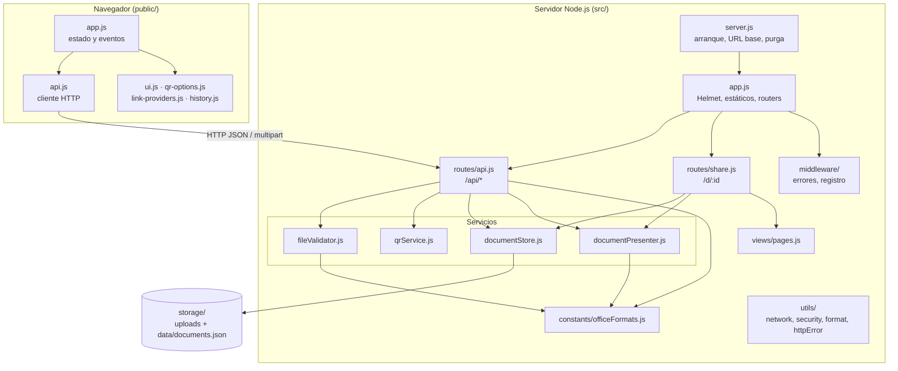
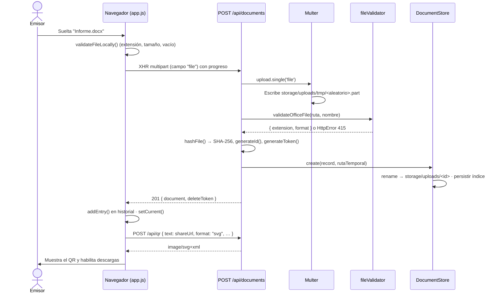
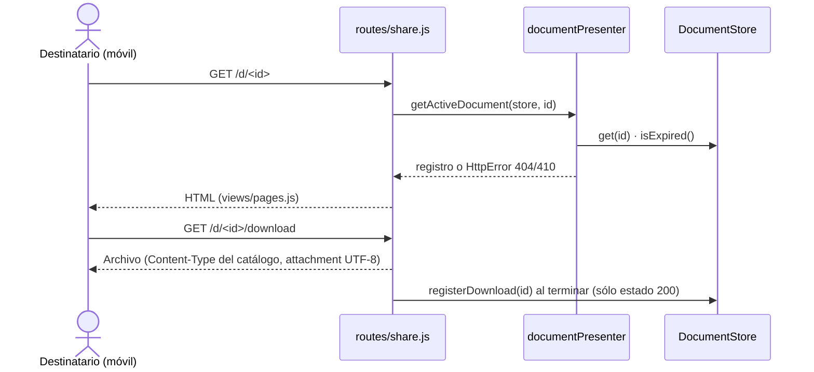
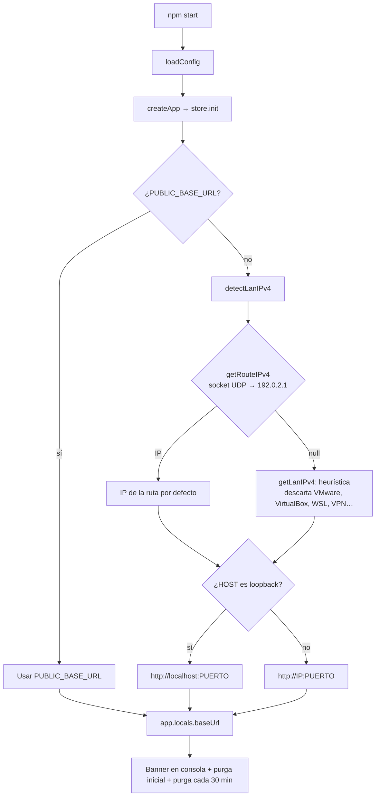

# Documentación técnica · QR Office

Guía para entender, mantener y ampliar el código de QR Office (versión 1.0.0). Para instalar y usar la aplicación,
consulta el [README](../README.md); para los requisitos formales, la [SRS IEEE 830](SRS-IEEE-830.md).

## Índice

1. [Visión general](#1-visión-general)
2. [Pila tecnológica](#2-pila-tecnológica)
3. [Arquitectura](#3-arquitectura)
4. [Estructura de archivos](#4-estructura-de-archivos)
5. [Flujos de datos](#5-flujos-de-datos)
6. [Módulos del servidor](#6-módulos-del-servidor)
7. [Referencia de la API](#7-referencia-de-la-api)
8. [Módulos del frontend](#8-módulos-del-frontend)
9. [Almacenamiento y modelo de datos](#9-almacenamiento-y-modelo-de-datos)
10. [Seguridad](#10-seguridad)
11. [Configuración](#11-configuración)
12. [Pruebas](#12-pruebas)
13. [Cómo extender o modificar el proyecto](#13-cómo-extender-o-modificar-el-proyecto)
14. [Convenciones de código](#14-convenciones-de-código)
15. [Decisiones de diseño](#15-decisiones-de-diseño)
16. [Limitaciones conocidas](#16-limitaciones-conocidas)

---

## 1. Visión general

QR Office tiene dos piezas:

- **Servidor** (`src/`, Node.js + Express): recibe documentos, los valida, los guarda en disco, genera imágenes QR y
  sirve la página de descarga.
- **Cliente** (`public/`, HTML + CSS + JavaScript nativos): aplicación de una página que sube documentos, pide los QR
  al servidor, los muestra y gestiona un historial local.

La idea central: **el QR nunca contiene el documento**, sino la URL `<URL base>/d/<id>` de su página de descarga. Por
eso es crucial que la *URL base* sea alcanzable desde el móvil que escanea (ver [5.5](#55-arranque-y-elección-de-la-url-base)).

## 2. Pila tecnológica

| Pieza | Tecnología | Motivo |
|-------|------------|--------|
| Entorno de ejecución | Node.js ≥ 22.9 (módulos ES) | Requisito del proyecto. Desde 22.9 permite `--env-file-if-exists`, así que no hace falta `dotenv`. |
| Servidor HTTP | Express 5 | Estándar de facto; la versión 5 propaga automáticamente los errores de los manejadores `async`. |
| Subida de archivos | Multer 2 | Procesa `multipart/form-data` escribiendo en disco por *streaming*, con límites de tamaño. |
| Generación de QR | `qrcode` 1.5 | Implementa ISO/IEC 18004; genera PNG (Buffer) y SVG (texto) en el servidor. |
| Cabeceras de seguridad | Helmet 8 | CSP, `nosniff`, `Referrer-Policy`, etc. con valores seguros por defecto. |
| Limitación de peticiones | `express-rate-limit` 8 | Protección básica frente a abuso. |
| Frontend | HTML5, CSS3 (variables, `color-mix`, grid), JavaScript ES2022 en módulos | Sin *frameworks* ni compilación: se edita y se recarga. |
| Pruebas | `node:test` + `fetch` nativo | Sin dependencias de desarrollo. |

## 3. Arquitectura



**Capas del servidor**

| Capa | Carpeta | Responsabilidad | No debe… |
|------|---------|-----------------|----------|
| Entrada | `server.js`, `app.js` | Arrancar, componer middleware y rutas. | Contener lógica de negocio. |
| Rutas | `routes/` | Traducir HTTP ↔ llamadas a servicios. Validar la forma de la petición. | Acceder directamente al disco. |
| Servicios | `services/` | Lógica: validar archivos, generar QR, persistir documentos, dar forma a la respuesta pública. | Conocer `req`/`res`. |
| Vistas | `views/` | Generar HTML escapado. | Tomar decisiones de negocio. |
| Utilidades | `utils/`, `constants/` | Funciones puras y datos compartidos. | Depender de capas superiores. |
| Transversal | `middleware/` | Errores y registro. | — |

## 4. Estructura de archivos

```text
src/
├── server.js                 Punto de entrada (npm start). Detecta la IP, abre el puerto, programa la purga.
├── app.js                    createApp(config): Helmet, estáticos, routers y manejo de errores.
├── config.js                 loadConfig(): lee y valida variables de entorno.
├── constants/
│   └── officeFormats.js      Catálogo de formatos y familias (única fuente de verdad).
├── middleware/
│   ├── errorHandler.js       Traduce cualquier error a JSON (API) o HTML (rutas públicas).
│   └── requestLogger.js      Registro de peticiones en consola.
├── routes/
│   ├── api.js                API REST /api/*.
│   └── share.js              Página de descarga /d/:id y descarga /d/:id/download.
├── services/
│   ├── documentStore.js      Persistencia: archivos en disco + índice JSON atómico.
│   ├── documentPresenter.js  Forma pública de un documento y búsqueda de documentos vigentes.
│   ├── fileValidator.js      Validación de extensión y firma binaria.
│   └── qrService.js          Validación de opciones y generación de PNG/SVG.
├── utils/
│   ├── format.js             Escapado HTML, tamaños, fechas, saneado de nombres.
│   ├── httpError.js          Clase HttpError(status, message, code).
│   ├── network.js            URL base: IP de la red local, clasificación de URL.
│   └── security.js           Identificadores, tokens, hashes y comparación segura.
└── views/
    └── pages.js              HTML de la página de descarga y de error.

public/
├── index.html                Estructura de la aplicación y sprite de iconos SVG.
├── css/styles.css            Estilos de la aplicación (tokens claro/oscuro).
├── css/share.css             Estilos de la página de descarga.
├── img/favicon.svg
└── js/
    ├── app.js                Orquestación: estado, eventos, flujos.
    ├── api.js                Cliente HTTP (fetch y XHR con progreso).
    ├── ui.js                 DOM, notificaciones, portapapeles, formato.
    ├── qr-options.js         Opciones del QR, persistencia y avisos de legibilidad.
    ├── link-providers.js     Validación de enlaces y detección del servicio.
    └── history.js            Historial en localStorage.

test/                         Pruebas con node:test (ver sección 12).
docs/                         SRS, esta guía y peticiones de ejemplo (api.http).
prototipo/                    Prototipo inicial sólo frontend; no se usa en ejecución.
storage/                      Datos en tiempo de ejecución (ignorado por Git).
```

## 5. Flujos de datos

### 5.1 Subida de un documento y generación del QR



Si cualquier paso falla, el bloque `finally` de la ruta borra el archivo temporal.

### 5.2 Escaneo y descarga



### 5.3 Vista previa y cambio de opciones

1. Cualquier cambio en el formulario de opciones dispara `input`.
2. `syncOptionLabels()` actualiza las etiquetas y los avisos (`getReadabilityWarnings`).
3. `saveOptions()` guarda las opciones en `localStorage`.
4. `renderPreviewSoon()` (con *debounce* de 200 ms) llama a `renderPreview()`, que pide el QR **en SVG** para que se
   vea nítido a cualquier tamaño.
5. Cada petición lleva un número de secuencia (`state.renderSeq`); las respuestas que llegan tarde se descartan.
6. Las descargas PNG/SVG y la copia de imagen se piden bajo demanda con las opciones vigentes, de modo que el PNG
   siempre tiene el tamaño seleccionado.

### 5.4 Eliminación

`deleteHistoryEntry()` pide confirmación → `DELETE /api/documents/:id` con `X-Delete-Token` → el servidor compara
`hashToken(token)` con `deleteTokenHash` usando `crypto.timingSafeEqual` → `store.remove(id)` borra archivo y registro →
el cliente quita la entrada del historial y, si era el QR visible, limpia la vista previa.

### 5.5 Arranque y elección de la URL base



`getRouteIPv4()` «conecta» un socket UDP a `192.0.2.1` (dirección reservada para documentación, RFC 5737). En UDP,
`connect` sólo consulta la tabla de rutas del sistema operativo: **no se envía ningún paquete**. La dirección local que
asigna el sistema es la de la interfaz con la ruta por defecto (el Wi-Fi o el cable), lo que evita elegir por error
adaptadores virtuales como los de VMware o VirtualBox.

Si `app.locals.baseUrl` es `null` (como en las pruebas), `getRequestBaseUrl(req)` usa el host de cada petición.

### 5.6 Caducidad y purga

- `store.isExpired(record)` compara `expiresAt` con el reloj (inyectable para pruebas).
- Las rutas usan `getActiveDocument()`, que devuelve `410` en cuanto un documento caduca, aunque aún no se haya purgado.
- `store.purgeExpired()` (al arrancar y cada 30 minutos, con `setInterval(...).unref()`) borra documentos caducados y
  temporales de más de 1 hora.

## 6. Módulos del servidor

### `src/server.js`

| Función | Descripción |
|---------|-------------|
| `main()` | Carga la configuración, crea la app, detecta la IP, abre el puerto, programa la purga y gestiona `SIGINT`/`SIGTERM`. Traduce `EADDRINUSE` y `EACCES` a mensajes claros. |
| `printBanner({ port, baseUrl, config })` | Muestra la URL local, la URL de los QR, los límites y avisos de alcance. |

### `src/app.js`

`createApp(config, { now })` → `Promise<{ app, store }>`. Inicializa `DocumentStore`, configura `trust proxy`,
`app.locals.baseUrl`, Helmet (CSP sin `upgrade-insecure-requests`, HSTS sólo con `https`), el registro de peticiones,
`express.static(public)`, `/api`, las rutas públicas, el 404 y el manejador de errores, **en ese orden**.

### `src/config.js`

`loadConfig(overrides = {}, env = process.env)` devuelve:

```js
{
  port, host, publicBaseUrl, maxFileSizeBytes, fileTtlHours, trustProxy,
  rateLimit: { windowMs, uploads, qr },
  logRequests, publicDir, storageDir, uploadsDir, dataDir
}
```

Valida rangos y lanza un error descriptivo si una variable es inválida. `overrides` tiene prioridad (lo usan las pruebas).

### `src/constants/officeFormats.js`

| Exportación | Descripción |
|-------------|-------------|
| `SIGNATURES` | Tipos de firma: `zip`, `ole2`, `pdf`, `rtf`, `jet`, `onenote`, `text`. |
| `CATEGORIES` | Familias con `id`, `label`, `description`, `color`, `badge` y `officeViewer`. |
| `FORMATS` | Mapa extensión → `{ category, signature, mime, name, macros? }` (37 entradas). |
| `getCategory(id)`, `getFormat(extension)` | Búsquedas seguras (usa `Object.hasOwn`). |
| `getPublicCatalog()` | `{ categories (con extensions), accept }` para el frontend. |

### `src/services/fileValidator.js`

| Función | Descripción |
|---------|-------------|
| `getExtension(filename)` | Extensión en minúsculas sin punto; `''` si no hay o si el nombre empieza por punto. |
| `matchesSignature(signature, header)` | `true` si los bytes cumplen la firma (tabla en la SRS, RF-04). |
| `readHeader(filePath, length = 8192)` | Lee los primeros bytes del archivo. |
| `validateOfficeFile(filePath, originalName)` | Devuelve `{ extension, format }` o lanza `HttpError 415` (`UNSUPPORTED_FORMAT` o `SIGNATURE_MISMATCH`). |

### `src/services/qrService.js`

| Exportación | Descripción |
|-------------|-------------|
| `QR_DEFAULTS` | `{ format: 'png', size: 512, margin: 4, ecc: 'M', fg: '#0F172A', bg: '#FFFFFF' }` |
| `QR_LIMITS` | Tamaño 128–2048, margen 0–10, 2953 bytes, niveles y formatos admitidos. |
| `normalizeQrOptions(input)` | Valida y normaliza (acepta cadenas de la query). Lanza `HttpError 400 INVALID_QR_OPTION`. |
| `assertEncodableText(text)` | `400 EMPTY_QR_TEXT` o `422 QR_TEXT_TOO_LONG`. |
| `renderQr(text, options)` | `{ body: Buffer \| string, contentType, extension }`. Traduce el error de capacidad de la librería a `422`. |

### `src/services/documentStore.js`

Clase `DocumentStore({ dataDir, uploadsDir, now })`:

| Miembro | Descripción |
|---------|-------------|
| `init()` | Crea carpetas, carga el índice (apartando uno dañado), descarta registros sin archivo y vacía `tmp/`. |
| `tmpDir`, `size` | Carpeta temporal de Multer y número de documentos. |
| `filePath(id)` | Ruta del archivo; valida el id contra `DOCUMENT_ID_PATTERN`. |
| `has(id)`, `get(id)` | Consulta (devuelve también caducados). |
| `isExpired(record)` | Comprueba la caducidad con el reloj inyectado. |
| `create(record, tempFilePath)` | Mueve el temporal y persiste. |
| `remove(id)` | Borra archivo y registro. |
| `registerDownload(id)` | Incrementa `downloads` y fija `lastDownloadAt`. |
| `purgeExpired()` | Borra caducados y temporales viejos; devuelve el número de documentos borrados. |
| `cleanTmp(maxAgeMs)` | Borra temporales más antiguos que `maxAgeMs`. |
| `#persist()` (privado) | Escritura atómica encadenada en `#writeQueue`. |

### `src/services/documentPresenter.js`

| Función | Descripción |
|---------|-------------|
| `buildShareUrl(baseUrl, id)` | `${baseUrl}/d/${id}` |
| `toPublicDocument(record, baseUrl)` | Objeto público (ver [7.3](#73-objeto-documento)). Nunca incluye `deleteTokenHash`. |
| `getActiveDocument(store, id)` | Registro vigente o `HttpError` 404/410. |

### `src/routes/api.js` y `src/routes/share.js`

`createApiRouter({ config, store })` y `createShareRouter({ store })` devuelven `express.Router`. Ver la
[referencia de la API](#7-referencia-de-la-api).

### `src/views/pages.js`

`renderDownloadPage({ document, category, format, viewerUrl })` y `renderErrorPage({ status, message })`. Todo valor
dinámico pasa por `escapeHtml`. El color de la familia se aplica con la variable CSS `--tile-color`.

### `src/middleware/`

- `notFoundHandler` genera `HttpError 404 NOT_FOUND`.
- `createErrorHandler(config)` traduce `HttpError`, `MulterError`, errores del parser JSON (`entity.parse.failed`,
  `entity.too.large`), `ENOENT` y errores 4xx genéricos; el resto se convierte en `500 INTERNAL_ERROR` y se registra.
- `requestLogger()` registra `fecha método ruta estado duración`.

### `src/utils/`

| Módulo | Funciones |
|--------|-----------|
| `format.js` | `escapeHtml`, `formatBytes`, `formatDate`, `decodeMulterFilename` (corrige nombres UTF-8 que Multer recibe como latin1), `sanitizeFilename`, `stripExtension`. |
| `security.js` | `DOCUMENT_ID_PATTERN`, `generateId` (9 bytes → 12 caracteres), `generateToken` (24 bytes → 32 caracteres), `hashToken`, `safeEqualHex`, `hashFile`. |
| `network.js` | `normalizeBaseUrl`, `getRouteIPv4`, `getLanIPv4`, `detectLanIPv4`, `buildDefaultBaseUrl`, `getRequestBaseUrl`, `describeBaseUrl` → `{ reachableFromOtherDevices, publicInternet }`. |
| `httpError.js` | `HttpError(status, message, code)`. |

## 7. Referencia de la API

Base: `<URL del servidor>/api`. Respuestas JSON en UTF-8. Errores: `{ "error": { "code": "…", "message": "…" } }`.

### 7.1 Endpoints

#### `GET /api/health`

```json
{ "status": "ok", "uptimeSeconds": 42, "documents": 3 }
```

#### `GET /api/config`

```json
{
  "baseUrl": "http://192.168.1.20:3000",
  "baseUrlSource": "lan",
  "reachableFromOtherDevices": true,
  "publicInternet": false,
  "maxFileSizeBytes": 26214400,
  "fileTtlHours": 168,
  "categories": [
    { "id": "word", "label": "Word", "description": "Documentos de texto", "color": "#2B579A",
      "badge": "W", "officeViewer": true, "extensions": ["doc", "docx", "docm", "dot", "dotx", "dotm", "rtf", "odt"] }
  ],
  "accept": ".doc,.docx,…",
  "qr": { "defaults": { "format": "png", "size": 512, "margin": 4, "ecc": "M", "fg": "#0F172A", "bg": "#FFFFFF" },
          "limits": { "minSize": 128, "maxSize": 2048, "minMargin": 0, "maxMargin": 10, "maxTextBytes": 2953,
                      "eccLevels": ["L", "M", "Q", "H"], "formats": ["png", "svg"] } }
}
```

`baseUrlSource`: `env` (PUBLIC_BASE_URL), `lan` (IP detectada), `localhost` o `request` (host de la petición).

#### `POST /api/documents`

`multipart/form-data` con un único archivo en el campo `file`. Respuesta `201` con cabecera
`Location: /api/documents/<id>`:

```json
{
  "document": { "id": "yO_mj67fKuc7", "originalName": "Informe.docx", "…": "ver 7.3" },
  "deleteToken": "q2M3…(32 caracteres)"
}
```

Guarda el `deleteToken`: es la única forma de eliminar el documento antes de que caduque.

#### `GET /api/documents/:id`

`200 { "document": { … } }` · `404` · `410`.

#### `GET /api/documents/:id/qr`

Parámetros de consulta opcionales: `format` (`png`|`svg`), `size`, `margin`, `ecc`, `fg`, `bg` (con o sin `#`; en la
URL escribe `%23` o omite la almohadilla) y `download` (cualquier valor fuerza la descarga).

```text
GET /api/documents/yO_mj67fKuc7/qr?size=1024&ecc=Q&fg=1F5FBF&download=1
```

#### `DELETE /api/documents/:id`

Cabecera obligatoria `X-Delete-Token`. Respuestas: `204` · `401` · `403` · `404`.

#### `POST /api/qr`

```json
{ "text": "https://contoso.sharepoint.com/:w:/g/abc", "format": "svg", "size": 512, "margin": 4, "ecc": "M", "fg": "#0F172A", "bg": "#FFFFFF" }
```

Sólo `text` es obligatorio. Cuerpo máximo de 16 KB. Devuelve la imagen.

### 7.2 Rutas públicas

| Ruta | Respuesta |
|------|-----------|
| `GET /d/:id` | HTML de la página de descarga; `404`/`410` en HTML si no está disponible. |
| `GET /d/:id/download` | Archivo original (`attachment`, admite `Range`). Cuenta la descarga si el estado es `200`. |

### 7.3 Objeto documento

| Campo | Ejemplo | Descripción |
|-------|---------|-------------|
| `id` | `"yO_mj67fKuc7"` | Identificador público. |
| `originalName` | `"Informe año 2026.docx"` | Nombre saneado. |
| `extension` | `"docx"` | |
| `formatName` | `"Documento de Word"` | Nombre legible del formato. |
| `category` / `categoryLabel` | `"word"` / `"Word"` | Familia. |
| `mimeType` | `"application/vnd.openxmlformats-officedocument.wordprocessingml.document"` | |
| `size` | `5000` | Bytes. |
| `sha256` | `"9f86d0…"` | Huella del archivo. |
| `macros` | `false` | `true` en `.docm`, `.xlsm`, `.xlsb`, `.pptm`, etc. |
| `createdAt` / `expiresAt` | ISO 8601 / ISO 8601 o `null` | |
| `downloads` | `0` | |
| `shareUrl` | `"http://192.168.1.20:3000/d/yO_mj67fKuc7"` | Lo que codifica el QR. |
| `downloadUrl` | `"…/d/yO_mj67fKuc7/download"` | Descarga directa. |
| `qrUrl` | `"/api/documents/yO_mj67fKuc7/qr"` | Imagen del QR (relativa al servidor). |

### 7.4 Códigos de error

| HTTP | `code` | Cuándo |
|------|--------|--------|
| 400 | `NO_FILE` | La subida no incluye archivo. |
| 400 | `EMPTY_FILE` | El archivo pesa 0 bytes. |
| 400 | `INVALID_UPLOAD` | Más de un archivo, campo distinto de `file` u otro error de Multer. |
| 400 | `INVALID_QR_OPTION` | Opción del QR fuera de rango, mal formada o colores iguales. |
| 400 | `EMPTY_QR_TEXT` | `POST /api/qr` sin `text`. |
| 400 | `INVALID_JSON` | Cuerpo JSON mal formado. |
| 400 | `BAD_REQUEST` | Otra petición mal formada. |
| 401 | `MISSING_TOKEN` | Falta `X-Delete-Token`. |
| 403 | `INVALID_TOKEN` | El token no corresponde al documento. |
| 404 | `DOCUMENT_NOT_FOUND` | El documento no existe. |
| 404 | `FILE_MISSING` | El registro existe pero el archivo no está en disco. |
| 404 | `NOT_FOUND` | Ruta inexistente. |
| 410 | `DOCUMENT_EXPIRED` | El documento ha caducado. |
| 413 | `FILE_TOO_LARGE` | Supera `MAX_FILE_SIZE_MB`. |
| 413 | `PAYLOAD_TOO_LARGE` | Cuerpo JSON de más de 16 KB. |
| 415 | `UNSUPPORTED_FORMAT` | Extensión fuera del catálogo. |
| 415 | `SIGNATURE_MISMATCH` | El contenido no corresponde a la extensión. |
| 422 | `QR_TEXT_TOO_LONG` | El texto no cabe en un QR con el nivel elegido. |
| 429 | `RATE_LIMITED` | Demasiadas peticiones. |
| 500 | `INTERNAL_ERROR` | Error inesperado (se registra en la consola). |

## 8. Módulos del frontend

Todos son módulos ES cargados con `<script type="module" src="/js/app.js">`; no hay variables globales.

### `public/js/app.js`

- **`state`**: `config`, `categories`, `extensionToCategory`, `current` (elemento mostrado), `previewObjectUrl`,
  `renderSeq`, `upload`.
- **`dom`**: referencias a los elementos por `id`, resueltas una sola vez.
- Funciones principales:

| Función | Descripción |
|---------|-------------|
| `init()` | Restaura opciones, enlaza eventos, pinta el historial y pide `/api/config`. |
| `applyConfig(config)` | Rellena categorías, `accept`, tamaño máximo, lista de formatos e indicador de alcance. |
| `selectTab(name)` | Cambia de pestaña (patrón ARIA). |
| `handleFile(file)` | Validación local → subida con progreso → historial → `setCurrent`. |
| `handleUrlSubmit(event)` | Valida el enlace, lo añade al historial y lo muestra. |
| `setCurrent(current)` / `clearCurrent()` | Cambian el elemento de la vista previa y el estado de los botones. |
| `renderPreview()` | Pide el SVG; descarta respuestas obsoletas con `renderSeq`. |
| `downloadQr(format, button)`, `copyQrImage()`, `copyLinkText(text)` | Exportación. |
| `renderHistory()`, `showHistoryEntry(entry)`, `deleteHistoryEntry(entry)` | Historial. |
| `bindEvents()` | Registra todos los manejadores. |

### `public/js/api.js`

`ApiError(status, code, message)`, `getConfig()`, `getDocument(id)`, `deleteDocument(id, token)`,
`renderQr(text, options, format)` → `Blob`, `uploadDocument(file, { onProgress })` → `{ promise, abort }`
(usa `XMLHttpRequest` porque `fetch` no informa del progreso de subida).

### `public/js/ui.js`

`byId`, `el(tag, { className, text, attrs }, children)`, `icon(name)` (usa el sprite de `index.html`),
`paintTile(tile, category)`, `formatBytes`, `formatDate`, `debounce`, `toast(message, type)`, `copyText(text)`
(API moderna o `execCommand` como alternativa en HTTP), `canCopyImages()`, `saveBlob(blob, filename)`, `toFileSlug(text)`.

### `public/js/qr-options.js`

`DEFAULT_OPTIONS`, `readOptions(form)`, `writeOptions(form, options)`, `loadSavedOptions()`, `saveOptions(options)`
(clave `qr-office:opciones:v1`), `relativeLuminance(hex)`, `contrastRatio(a, b)` y `getReadabilityWarnings(options)`.

### `public/js/link-providers.js`

`parseShareLink(value)` → `{ ok, url, provider }` o `{ ok: false, error }`; `detectProvider(hostname)`.

### `public/js/history.js`

`loadHistory()`, `addEntry(entry)`, `updateEntry(id, changes)`, `removeEntry(id)`, `clearHistory()`, `randomId()`.
Clave `qr-office:historial:v1`, máximo 30 entradas. Todo acceso a `localStorage` está protegido con `try/catch`
(navegación privada o almacenamiento bloqueado).

### Estilos

`styles.css` define los *tokens* de diseño en `:root` y los redefine en `@media (prefers-color-scheme: dark)`. Para
cambiar la identidad visual basta con modificar `--accent`, `--accent-hover`, `--accent-soft` y `--on-accent`. Las
rejillas usan `minmax(0, 1fr)` para que los textos largos (URL) nunca provoquen desplazamiento horizontal en móvil.

## 9. Almacenamiento y modelo de datos

```text
storage/
├── data/
│   └── documents.json        { "version": 1, "documents": [ …registros… ] }
└── uploads/
    ├── tmp/                  Subidas en curso (*.part); se limpian solas.
    └── yO_mj67fKuc7          Un archivo por documento, sin extensión.
```

El modelo completo del registro está en la [SRS, Apéndice C](SRS-IEEE-830.md#apéndice-c-modelo-de-datos). Para hacer
una copia de seguridad basta con copiar la carpeta `storage/` con el servidor detenido.

## 10. Seguridad

| Amenaza | Mitigación | Dónde |
|---------|------------|-------|
| Subir ejecutables o scripts disfrazados | Lista blanca de extensiones + firma binaria | `fileValidator.js` |
| Ejecución o renderizado del archivo subido | Guardado fuera de `public/`, sin extensión; servido como `attachment` con `nosniff` | `documentStore.js`, `share.js`, Helmet |
| *Path traversal* | Los ids se validan con `^[A-Za-z0-9_-]{12}$`; el nombre original nunca se usa como ruta | `security.js`, `documentStore.js` |
| XSS en la página de descarga | `escapeHtml` en toda interpolación; CSP `script-src 'self'` | `pages.js`, `app.js` |
| XSS en la aplicación | El DOM se construye con `textContent`/`createElement`, nunca con `innerHTML` de datos | `public/js/*` |
| Enumeración de documentos | Ids aleatorios de 72 bits; no existe un endpoint que liste documentos | `security.js`, `api.js` |
| Borrado por terceros | Token de 192 bits, guardado como SHA-256 y comparado en tiempo constante | `api.js`, `security.js` |
| Abuso / denegación de servicio | Límites de tamaño, de cuerpo y de frecuencia | `api.js`, `config.js` |
| Indexación por buscadores | `X-Robots-Tag` y `<meta name="robots" content="noindex">` | `share.js`, `pages.js` |
| Macros maliciosas | Aviso en la página de descarga de los formatos con macros | `pages.js`, `officeFormats.js` |

**Notas:**

- `style-src` incluye `'unsafe-inline'` sólo para permitir `style="--tile-color:…"` en la página de descarga; el valor
  procede siempre del catálogo, no del usuario.
- Cualquiera que tenga el QR puede descargar el documento mientras esté disponible. No subas información confidencial
  si el QR va a estar expuesto públicamente.
- En Internet, publica siempre detrás de HTTPS (proxy inverso) y define `PUBLIC_BASE_URL=https://…` y `TRUST_PROXY`.

## 11. Configuración

Todas las variables están documentadas en [`.env.example`](../.env.example) y en el [README](../README.md#configuración).
`loadConfig` valida tipos y rangos al arrancar: una variable incorrecta detiene el servidor con un mensaje como
`La variable MAX_FILE_SIZE_MB debe ser un entero entre 1 y 1024 (valor recibido: "abc")`.

## 12. Pruebas

```powershell
npm test
```

| Archivo | Qué cubre |
|---------|-----------|
| `test/helpers.js` | `startTestServer()` (app aislada en puerto aleatorio con almacenamiento temporal), `uploadFile()`, `sampleFile()` con cabeceras de cada firma. |
| `test/fileValidator.test.js` | Extensiones, coherencia del catálogo, firmas válidas e inválidas, ejecutable renombrado. |
| `test/qrService.test.js` | Normalización y rechazo de opciones, PNG y SVG válidos, capacidad máxima. |
| `test/api.test.js` | Ciclo completo (subida → página → descarga → contador → QR → eliminación), formatos clásicos, rechazos, `POST /api/qr`, 404, tamaño máximo, caducidad con reloj simulado, Office para la Web, cabeceras de seguridad. |
| `test/network.test.js` | Elección de IP con adaptadores virtuales, ruta por defecto, clasificación de URL, saneado de nombres. |

Para añadir una prueba de API, crea el servidor con `startTestServer(overrides, { now })` y ciérralo con `close()` en
un bloque `finally` o en `after()`.

La interfaz se verifica manualmente en el navegador (escritorio y móvil de 375 px): subida, vista previa, avisos de
legibilidad, enlace de SharePoint/OneDrive, historial y ausencia de desplazamiento horizontal.

## 13. Cómo extender o modificar el proyecto

### 13.1 Añadir un formato de archivo

1. Añade la entrada en `FORMATS` (`src/constants/officeFormats.js`):

   ```js
   xlam: { category: 'excel', signature: ZIP, mime: 'application/vnd.ms-excel.addin.macroEnabled.12', name: 'Complemento de Excel', macros: true },
   ```

2. Si la firma es nueva, añade la constante en `SIGNATURES` y su `case` en `matchesSignature()`
   (`src/services/fileValidator.js`).
3. Añade un caso a `test/fileValidator.test.js`. El frontend lo mostrará automáticamente.

### 13.2 Añadir una familia de documentos

Añade un objeto a `CATEGORIES` con `id`, `label`, `description`, `color`, `badge` y `officeViewer`, y asígnala a sus
formatos. La lista de formatos, los iconos y la página de descarga se actualizan solos.

### 13.3 Cambiar límites y valores por defecto

- Tamaño, caducidad y frecuencias: variables de entorno.
- Opciones del QR: `QR_DEFAULTS`/`QR_LIMITS` en `qrService.js` **y** `DEFAULT_OPTIONS` en `public/js/qr-options.js`
  (y, si cambian, las opciones del `<select id="size">` de `index.html`).
- Intervalo de purga: `PURGE_INTERVAL_MS` en `server.js`. Antigüedad de temporales: `STALE_TMP_MS` en `documentStore.js`.

### 13.4 Añadir un endpoint

1. Crea la ruta en `src/routes/api.js` (manejador `async`; lanza `HttpError` para los errores previstos).
2. Pon la lógica en un servicio de `src/services/`.
3. Añade la función cliente en `public/js/api.js`.
4. Documenta el endpoint en la sección 7 y en `docs/api.http`, y añade una prueba en `test/api.test.js`.

### 13.5 Sustituir el almacenamiento (base de datos, S3, Azure Blob…)

Las rutas sólo usan esta interfaz de `DocumentStore`:

```text
init() · tmpDir · size · filePath(id) · has(id) · get(id) · isExpired(record)
create(record, tempFilePath) · remove(id) · registerDownload(id) · purgeExpired()
```

Crea una clase con los mismos métodos (por ejemplo, metadatos en SQLite/PostgreSQL y archivos en S3) y cámbiala en
`createApp()`. Si los archivos dejan de estar en disco, sustituye en `share.js` el `res.download(store.filePath(id))` por
un *stream* desde el almacenamiento (`getObject(...).pipe(res)`) o por una redirección a una URL prefirmada.

### 13.6 Añadir un logotipo al QR

1. Fuerza `ecc: 'H'` cuando haya logotipo (el 30 % de redundancia compensa la zona tapada).
2. Para SVG: inserta un `<image>` centrado que ocupe como máximo el 20 % del lado.
3. Para PNG: compón la imagen con una librería como `sharp` tras `QRCode.toBuffer`.
4. Expón la opción en `normalizeQrOptions` y en el formulario de opciones.

### 13.7 Añadir autenticación

Para restringir quién puede **subir**, añade un middleware delante de `POST /api/documents` (por ejemplo, una clave en
una cabecera comparada con `safeEqualHex`, o un proveedor OpenID Connect). Las rutas `/d/:id` deben seguir siendo
públicas para que el QR funcione, salvo que se quiera exigir también inicio de sesión al destinatario.

### 13.8 Publicar en Internet

1. Ejecuta el servidor con un gestor de procesos (servicio de Windows, `systemd` o `pm2`).
2. Pon delante un proxy inverso con HTTPS (Caddy, nginx, IIS) o un túnel (Cloudflare Tunnel).
3. Define `PUBLIC_BASE_URL=https://tu-dominio`, `TRUST_PROXY=1` y, si quieres, `HOST=127.0.0.1` para que sólo el proxy
   acceda al puerto.
4. Ajusta `MAX_FILE_SIZE_MB` también en el proxy (por ejemplo, `client_max_body_size` en nginx).

### 13.9 Traducir la interfaz

Los textos están en `public/index.html`, `public/js/*.js`, `src/views/pages.js` y los mensajes de `HttpError`. Para
varios idiomas, centraliza los textos en un diccionario por idioma (por ejemplo, `public/js/i18n/es.js`) y elige el
idioma con `navigator.language` o el encabezado `Accept-Language` en el servidor.

## 14. Convenciones de código

- Módulos ES (`import`/`export`), extensión `.js` explícita en las importaciones.
- `camelCase` para variables y funciones, `PascalCase` para clases, `UPPER_SNAKE_CASE` para constantes.
- Nombres de funciones con verbo (`renderQr`, `validateOfficeFile`, `getActiveDocument`).
- Errores previstos con `HttpError`; nunca se envía la traza de un error al cliente.
- Comentarios en español: JSDoc en funciones exportadas y comentarios en línea sólo donde el «porqué» no es evidente.
- Formato: 2 espacios, comillas simples, punto y coma, LF, máximo 140 columnas (`.editorconfig`, `.prettierrc.json`).
- En el frontend, el DOM se crea con `el()`/`textContent`; no se usa `innerHTML` con datos.

## 15. Decisiones de diseño

| Decisión | Alternativa descartada | Motivo |
|----------|------------------------|--------|
| El QR codifica una URL a una página de descarga | Incrustar el archivo (prototipo) | Un QR admite ~2,9 KB; los documentos de Office pesan mucho más. |
| QR generado en el servidor | Librería QR en el navegador | Un único generador para la app, la API y la página de descarga; sin CDN. |
| Vista previa en SVG, descargas bajo demanda | Un único PNG | Nitidez a cualquier tamaño de pantalla; el PNG descargado siempre tiene la resolución elegida. |
| Índice JSON con escritura atómica | SQLite u otra base de datos | Cero dependencias nativas; suficiente para uso personal o de equipo. |
| Token de eliminación sin cuentas | Sistema de usuarios | Mantiene la aplicación simple (supuesto S-04 de la SRS). |
| Detección de IP por la tabla de rutas | Primera IP privada encontrada | En equipos con VMware/VirtualBox/WSL la primera IP privada suele ser virtual. |
| Sin *frameworks* en el frontend | React/Vue + empaquetador | Requisito de HTML/CSS/JS; facilita el aprendizaje y no requiere compilación. |
| `node:test` | Jest/Mocha | Sin dependencias de desarrollo. |

Los supuestos de interpretación de la idea base están en la [SRS, sección 2.5](SRS-IEEE-830.md#25-suposiciones-y-dependencias).

## 16. Limitaciones conocidas

- La validación por firma no distingue entre formatos que comparten contenedor (un `.xlsx` renombrado a `.docx` pasa la
  validación, aunque el destinatario lo descargará con la extensión equivocada).
- El índice JSON se reescribe completo en cada cambio: con decenas de miles de documentos convendría una base de datos.
- Si se borra el almacenamiento del navegador, se pierden los tokens de eliminación (los documentos caducarán igualmente).
- *Copiar imagen* no está disponible al acceder por `http://IP` (limitación de los navegadores).
- La limitación de frecuencia se guarda en memoria: se reinicia con el servidor y no se comparte entre instancias.
