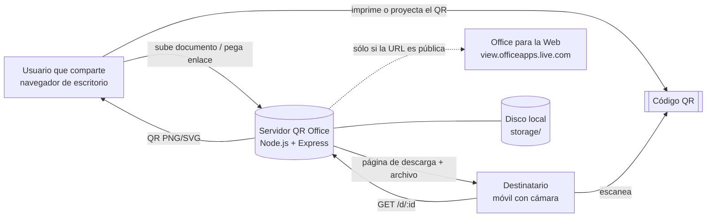
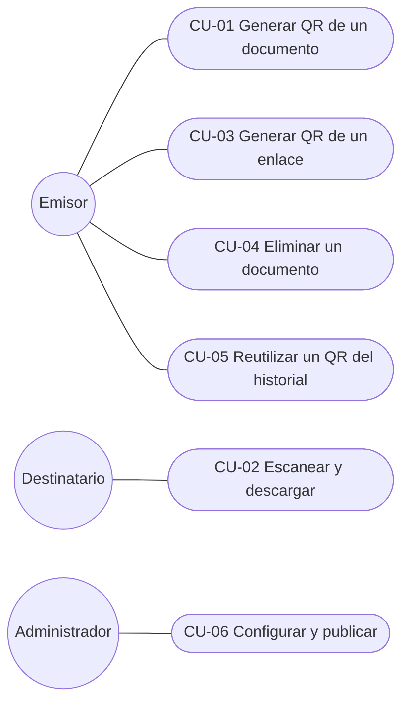

# Especificación de Requisitos de Software (SRS)

## QR Office · Generador de códigos QR para documentos de Office

| Campo | Valor |
|-------|-------|
| Norma de referencia | IEEE Std 830-1998 — *Recommended Practice for Software Requirements Specifications* |
| Versión del documento | 1.0 |
| Versión del software | 1.0.0 (`package.json`) |
| Fecha | 25 de noviembre de 2026 |
| Repositorio | <https://github.com/JeroSoto/generador_qr> |
| Estado | Aprobado para la versión 1.0.0 |

### Historial de revisiones

| Versión | Fecha | Descripción |
|---------|-------|-------------|
| 1.0 | 2026-11-25 | Primera versión. Sustituye al prototipo sólo frontend (`prototipo/generador_de_qr_para_archivos.html`) por una aplicación cliente-servidor con Node.js. |

---

## Índice

1. [Introducción](#1-introducción)
   1. [Propósito](#11-propósito)
   2. [Ámbito del sistema](#12-ámbito-del-sistema)
   3. [Definiciones, acrónimos y abreviaturas](#13-definiciones-acrónimos-y-abreviaturas)
   4. [Referencias](#14-referencias)
   5. [Visión general del documento](#15-visión-general-del-documento)
2. [Descripción general](#2-descripción-general)
   1. [Perspectiva del producto](#21-perspectiva-del-producto)
   2. [Funciones del producto](#22-funciones-del-producto)
   3. [Características de los usuarios](#23-características-de-los-usuarios)
   4. [Restricciones](#24-restricciones)
   5. [Suposiciones y dependencias](#25-suposiciones-y-dependencias)
   6. [Requisitos futuros](#26-requisitos-futuros)
3. [Requisitos específicos](#3-requisitos-específicos)
   1. [Interfaces externas](#31-requisitos-de-interfaces-externas)
   2. [Requisitos funcionales](#32-requisitos-funcionales)
   3. [Requisitos de rendimiento](#33-requisitos-de-rendimiento)
   4. [Restricciones de diseño](#34-restricciones-de-diseño)
   5. [Atributos del sistema](#35-atributos-del-sistema-de-software)
   6. [Otros requisitos](#36-otros-requisitos)
4. [Apéndices](#4-apéndices)

---

## 1. Introducción

### 1.1 Propósito

Este documento especifica los requisitos de **QR Office**, una aplicación web que genera códigos QR para compartir
documentos de oficina. Define qué debe hacer el sistema, con qué restricciones y con qué atributos de calidad, de modo
que sirva como:

- Acuerdo de referencia entre quien solicita el producto y quien lo desarrolla.
- Base para el diseño, la implementación y las pruebas (ver la matriz de trazabilidad del [Apéndice B](#apéndice-b-matriz-de-trazabilidad)).
- Punto de partida para estimar y planificar versiones futuras.

Está dirigido a desarrolladores, responsables de pruebas, administradores que desplieguen la aplicación y a la persona
propietaria del producto.

### 1.2 Ámbito del sistema

**Nombre del producto:** QR Office (paquete npm `generador-qr-office`).

**Qué hace:**

- Recibe un documento de oficina, lo valida, lo almacena en el servidor y genera un código QR que apunta a una página
  pública de descarga de ese documento.
- Genera códigos QR para enlaces de documentos alojados en servicios en la nube (OneDrive, SharePoint, Google Drive, etc.).
- Permite personalizar y descargar el QR en PNG o SVG.
- Elimina automáticamente los documentos cuando caducan.

**Qué no hace (fuera de alcance de la versión 1.0):**

- No incrusta el documento dentro del QR (la capacidad máxima de un QR, unos 2,9 KB, es muy inferior al tamaño de un
  documento de Office).
- No edita, convierte ni previsualiza internamente los documentos.
- No gestiona cuentas de usuario, contraseñas ni permisos por persona.
- No analiza los archivos con un antivirus.
- No sube documentos a servicios en la nube de terceros.

**Beneficios y objetivos:** compartir documentos impresos o proyectados (carteles, presentaciones, aulas, reuniones,
etiquetas de inventario) de forma inmediata, sin enviar correos ni depender de una cuenta en la nube, y manteniendo el
control de los archivos en un servidor propio.

### 1.3 Definiciones, acrónimos y abreviaturas

| Término | Definición |
|---------|------------|
| **Código QR** | *Quick Response code*, símbolo bidimensional definido en ISO/IEC 18004. |
| **Documento** | Archivo de oficina subido por el usuario y almacenado por el sistema. |
| **Página de descarga** | Página HTML pública (`/d/:id`) que se abre al escanear el QR de un documento. |
| **Enlace para compartir** (`shareUrl`) | URL de la página de descarga; es el contenido que codifica el QR de un documento. |
| **URL base** | Esquema, host y puerto con los que se construyen los enlaces para compartir. |
| **Token de eliminación** | Secreto aleatorio que se entrega al subir un documento y permite borrarlo. |
| **Firma binaria** (*magic number*) | Secuencia de bytes al inicio de un archivo que identifica su formato. |
| **OOXML** | Office Open XML (ISO/IEC 29500): formatos `.docx`, `.xlsx`, `.pptx`, etc. Son contenedores ZIP. |
| **OLE2 / CFB** | Compound File Binary: contenedor de los formatos de Office 97-2003 (`.doc`, `.xls`, `.ppt`…). |
| **ODF** | OpenDocument Format (ISO/IEC 26300): `.odt`, `.ods`, `.odp`. |
| **ECC** | *Error Correction Capability*: nivel de corrección de errores del QR (L 7 %, M 15 %, Q 25 %, H 30 %). |
| **Zona silenciosa** | Margen claro alrededor del QR, medido en módulos. La norma recomienda 4. |
| **Módulo** | Cada uno de los cuadrados que forman el QR. |
| **Caducidad (TTL)** | Tiempo tras el cual un documento se elimina automáticamente. |
| **LAN** | Red de área local (por ejemplo, la Wi-Fi de casa u oficina). |
| **API REST** | Interfaz HTTP del servidor bajo el prefijo `/api`. |
| **CSP** | *Content Security Policy*, cabecera HTTP que limita los recursos que puede cargar una página. |
| **SRS** | *Software Requirements Specification* (este documento). |
| **RF / RNF** | Requisito funcional / requisito no funcional. |

### 1.4 Referencias

1. IEEE Std 830-1998, *IEEE Recommended Practice for Software Requirements Specifications*.
2. ISO/IEC 18004:2015, *Information technology — Automatic identification and data capture techniques — QR Code bar code symbology specification*.
3. ISO/IEC 29500, *Office Open XML File Formats*.
4. [MS-CFB] *Compound File Binary File Format*, Microsoft Open Specifications.
5. ISO/IEC 26300, *Open Document Format for Office Applications (OpenDocument)*.
6. RFC 9110, *HTTP Semantics*; RFC 6266, *Use of the Content-Disposition Header Field*; RFC 5987/8187, codificación de parámetros de cabecera.
7. RFC 5737, *IPv4 Address Blocks Reserved for Documentation*.
8. W3C, *Web Content Accessibility Guidelines (WCAG) 2.2*.
9. Documentación de Node.js 22/24, Express 5, Multer 2, `qrcode` 1.5, Helmet 8 y `express-rate-limit` 8.
10. [README.md](../README.md) y [DOCUMENTACION-TECNICA.md](DOCUMENTACION-TECNICA.md) de este repositorio.

### 1.5 Visión general del documento

- La **sección 2** describe el producto en términos generales: contexto, funciones, usuarios, restricciones y supuestos.
- La **sección 3** detalla los requisitos verificables: interfaces, requisitos funcionales (RF), de rendimiento (RR),
  restricciones de diseño (RD) y atributos de calidad (RNF).
- La **sección 4** contiene los casos de uso, la matriz de trazabilidad y el modelo de datos.

---

## 2. Descripción general

### 2.1 Perspectiva del producto

QR Office es un producto independiente y autocontenido. Sustituye a un prototipo previo que funcionaba sólo en el
navegador y que *simulaba* el alojamiento de archivos: en esta versión el alojamiento es real.

**Interfaces del sistema con su entorno:**

- Navegador web del usuario que genera el QR (aplicación de una sola página servida por el propio servidor).
- Navegador del destinatario (página de descarga).
- Sistema de archivos local (documentos e índice JSON).
- Opcionalmente, el visor de Office para la Web de Microsoft, al que sólo se enlaza; el servidor nunca le envía datos.

### 2.2 Funciones del producto

1. Publicar documentos de oficina y generar su QR.
2. Generar QR de enlaces a documentos en la nube.
3. Personalizar el aspecto y la robustez del QR, con avisos de legibilidad.
4. Exportar el QR (PNG, SVG, portapapeles).
5. Ofrecer una página de descarga adaptada al móvil.
6. Llevar un historial local de los QR generados y permitir eliminar documentos.
7. Caducar y purgar documentos automáticamente.
8. Determinar automáticamente una URL base alcanzable desde otros dispositivos.

### 2.3 Características de los usuarios

| Perfil | Descripción | Conocimientos técnicos |
|--------|-------------|------------------------|
| **Emisor** | Persona que sube el documento y obtiene el QR (docente, administrativo, comercial, estudiante). | Uso básico de un navegador y de archivos de Office. |
| **Destinatario** | Persona que escanea el QR con el móvil para obtener el documento. | Saber usar la cámara del móvil. |
| **Administrador** | Persona que instala, configura y mantiene el servidor. | Línea de comandos, Node.js, redes locales y, para publicar en Internet, nociones de proxies/DNS. |

La interfaz está íntegramente en español.

### 2.4 Restricciones

- **R-01** El servidor debe ejecutarse con Node.js 22.9 o superior.
- **R-02** No se dispone de base de datos: la persistencia se basa en el sistema de archivos.
- **R-03** La capacidad física de un QR (2953 bytes en modo byte con ECC L, versión 40) impide incrustar documentos.
- **R-04** Para que un dispositivo pueda abrir el QR, la URL base debe ser alcanzable desde ese dispositivo.
- **R-05** Office para la Web sólo puede previsualizar documentos accesibles públicamente desde Internet.
- **R-06** Las API del portapapeles de imágenes sólo están disponibles en contextos seguros (HTTPS o `localhost`).
- **R-07** La documentación y los comentarios del código deben estar en español.

### 2.5 Suposiciones y dependencias

La idea base del proyecto («generador de QR para todo tipo de documento Office») admite varias interpretaciones. Se han
adoptado las siguientes, aplicadas de forma coherente en el código y la documentación:

| Id | Supuesto |
|----|----------|
| **S-01** | «Todo tipo de documento Office» abarca la suite Microsoft Office completa (Word, Excel, PowerPoint, Access, Visio, Publisher, Project, OneNote y mensajes de Outlook), sus plantillas y variantes con macros, los equivalentes OpenDocument y los formatos de oficina habituales PDF, RTF, CSV y TXT. En total, 37 extensiones. |
| **S-02** | Como un documento no cabe en un QR, el QR codifica la URL de una página de descarga alojada por la propia aplicación. Se descarta el modo de «incrustación directa» del prototipo. |
| **S-03** | El uso principal es un servidor en el equipo del usuario y destinatarios en la misma red local. Para el acceso desde Internet, el administrador publica la aplicación y define `PUBLIC_BASE_URL`. |
| **S-04** | No hay cuentas de usuario. La propiedad de un documento se demuestra con su token de eliminación, que el navegador del emisor guarda en su historial local. |
| **S-05** | Los documentos caducan a los 7 días (168 h) por defecto; es configurable y puede desactivarse. |
| **S-06** | El tamaño máximo por documento es de 25 MB por defecto; es configurable entre 1 y 1024 MB. |
| **S-07** | El modo «enlace en la nube» acepta cualquier URL `http`/`https`; la detección del proveedor es sólo informativa. |
| **S-08** | La validación del contenido se basa en la firma binaria; no se analiza la estructura interna ni se buscan virus. |
| **S-09** | El historial y las preferencias se guardan en el `localStorage` del navegador; no se sincronizan entre dispositivos. |
| **S-10** | El proyecto se publica con licencia MIT. |

**Dependencias:** Express 5, Multer 2, `qrcode` 1.5, Helmet 8, `express-rate-limit` 8 (ver `package.json`). El
frontend no depende de librerías ni CDN externos.

### 2.6 Requisitos futuros

Identificados pero aplazados a versiones posteriores:

- Cuentas de usuario y panel de administración con todos los documentos.
- Almacenamiento en la nube (S3, Azure Blob, R2) y base de datos.
- Logotipo en el centro del QR y estilos de módulos redondeados.
- Protección de documentos con contraseña o límite de descargas.
- Análisis antivirus de los archivos subidos.
- Vista previa propia de los documentos (conversión a PDF o imagen).
- Internacionalización de la interfaz.

---

## 3. Requisitos específicos

Cada requisito tiene un identificador único y una prioridad: **Alta** (imprescindible para la versión 1.0),
**Media** (importante) o **Baja** (deseable).

### 3.1 Requisitos de interfaces externas

#### 3.1.1 Interfaces de usuario

- **IU-01** Aplicación de una página (`/`) con tres bloques numerados: *1. Elige el origen*, *2. Personaliza el QR* y
  *3. Tu código QR*, más un bloque de *Historial*.
- **IU-02** El bloque de origen tiene dos pestañas accesibles (patrón ARIA *tabs*, navegables con flechas): *Subir
  documento* (zona de arrastrar y soltar con selector de archivo) y *Enlace en la nube* (campo URL y botón *Generar QR*).
- **IU-03** La vista previa muestra el QR, el nombre del elemento, metadatos, el enlace codificado con botón de copiar y
  los botones *Descargar PNG*, *SVG*, *Copiar imagen* y *Abrir enlace*, deshabilitados hasta que exista un QR.
- **IU-04** La cabecera muestra un indicador de alcance de los QR: *Red local*, *Público* o *Sólo este equipo*.
- **IU-05** La página de descarga muestra icono de familia, nombre, tipo, tamaño, fecha de subida, caducidad, número de
  descargas, botón *Descargar documento*, enlace opcional a Office para la Web, aviso de macros y huella SHA-256.
- **IU-06** Los errores se comunican con mensajes en español: notificaciones emergentes en la aplicación y páginas de
  error en las rutas públicas.
- **IU-07** El diseño se adapta desde 320 px de ancho, sin desplazamiento horizontal, y respeta el tema claro u oscuro del sistema.

#### 3.1.2 Interfaces de hardware

- **IH-01** Servidor: cualquier equipo capaz de ejecutar Node.js 22.9+, con espacio en disco para los documentos y una
  interfaz de red.
- **IH-02** Cliente emisor: equipo con navegador moderno. Cliente destinatario: dispositivo con cámara capaz de leer
  códigos QR y navegador.

#### 3.1.3 Interfaces de software

- **IS-01** Sistema operativo: Windows 10/11, macOS o Linux.
- **IS-02** Navegadores: versiones actuales de Chrome, Edge, Firefox y Safari (módulos ES, `fetch`, `FormData`, `localStorage`).
- **IS-03** Office para la Web: el sistema sólo construye un enlace `https://view.officeapps.live.com/op/view.aspx?src=<URL de descarga>`.

#### 3.1.4 Interfaces de comunicaciones

- **IC-01** HTTP/1.1 sobre TCP en el puerto configurable `PORT` (3000 por defecto). HTTPS se delega en un proxy inverso.
- **IC-02** API REST con JSON (UTF-8) y `multipart/form-data` para la subida. Formato de error:
  `{ "error": { "code": string, "message": string } }`.
- **IC-03** Las imágenes QR se devuelven como `image/png` o `image/svg+xml`.

### 3.2 Requisitos funcionales

#### RF-01 · Consultar la configuración pública — Prioridad Alta

- **Entrada:** `GET /api/config`.
- **Proceso:** reunir la URL base vigente, su origen (`env`, `lan`, `localhost` o `request`), su alcance, el tamaño
  máximo, la caducidad, el catálogo de categorías con sus extensiones, la cadena `accept` y los valores por defecto y
  límites del QR.
- **Salida:** JSON `200`. El frontend lo usa para pintar la lista de formatos, el límite de tamaño y el indicador de alcance.

#### RF-02 · Subir un documento — Prioridad Alta

- **Entrada:** `POST /api/documents`, `multipart/form-data` con un único archivo en el campo `file`.
- **Proceso:** recibir el archivo en una carpeta temporal con nombre aleatorio, por *streaming* a disco.
- **Validaciones y errores:**
  - Sin archivo → `400 NO_FILE`.
  - Archivo vacío → `400 EMPTY_FILE`.
  - Más de un archivo o campo distinto de `file` → `400 INVALID_UPLOAD`.
  - Tamaño superior a `MAX_FILE_SIZE_MB` → `413 FILE_TOO_LARGE`.
  - Más de `RATE_LIMIT_UPLOADS` subidas por IP en 15 minutos → `429 RATE_LIMITED`.
- **Salida:** `201` con cabecera `Location` y JSON `{ document, deleteToken }` (ver RF-05).
- **Interfaz:** el frontend valida antes de enviar (extensión, tamaño y archivo vacío), muestra el progreso de la subida
  y permite cancelarla.

#### RF-03 · Validar el formato por extensión — Prioridad Alta

- El sistema debe aceptar exclusivamente las 37 extensiones del catálogo (`src/constants/officeFormats.js`), sin
  distinguir mayúsculas.
- Una extensión no admitida o ausente → `415 UNSUPPORTED_FORMAT`.

#### RF-04 · Validar el contenido por firma binaria — Prioridad Alta

- El sistema debe leer los primeros 8 KB del archivo y comprobar la firma correspondiente a su extensión:

  | Firma | Formatos | Comprobación |
  |-------|----------|--------------|
  | ZIP | OOXML, ODF, `.vsdx` | Bytes `50 4B 03 04` |
  | OLE2 | Office 97-2003, `.vsd`, `.pub`, `.mpp`, `.msg` | Bytes `D0 CF 11 E0 A1 B1 1A E1` |
  | PDF | `.pdf` | `%PDF-` dentro del primer KB |
  | RTF | `.rtf` | `{\rtf` (admite BOM UTF-8) |
  | JET | `.mdb`, `.accdb` | `00 01 00 00` + `Standard Jet DB` / `Standard ACE DB` |
  | OneNote | `.one` | GUID `E4 52 5C 7B 8C D8 A7 4D AE B1 53 78 D0 29 96 D3` |
  | Texto | `.csv`, `.txt` | Sin bytes nulos (o UTF-16 con BOM) |

- Si no coincide → `415 SIGNATURE_MISMATCH` y el archivo temporal se elimina.

#### RF-05 · Registrar el documento — Prioridad Alta

- Para cada documento válido el sistema debe:
  1. Generar un identificador público aleatorio de 12 caracteres base64url (72 bits), único.
  2. Generar un token de eliminación de 32 caracteres base64url (192 bits) y guardar sólo su hash SHA-256.
  3. Calcular la huella SHA-256 del archivo.
  4. Sanear el nombre original (ver SEG-07) y corregir su codificación UTF-8.
  5. Mover el archivo a `storage/uploads/<id>` (sin extensión).
  6. Guardar los metadatos (ver [Apéndice C](#apéndice-c-modelo-de-datos)) con `expiresAt = createdAt + FILE_TTL_HOURS`,
     o `null` si `FILE_TTL_HOURS = 0`.
- La respuesta pública nunca debe incluir el hash del token ni rutas del servidor.

#### RF-06 · Generar el QR de un documento — Prioridad Alta

- **Entrada:** `GET /api/documents/:id/qr` con parámetros opcionales de RF-08 y `download`.
- **Proceso:** codificar el enlace para compartir `<URL base>/d/<id>`.
- **Salida:** imagen PNG o SVG. Con `download` presente, `Content-Disposition: attachment; filename="qr-<nombre>.<ext>"`.
- **Errores:** documento inexistente → `404 DOCUMENT_NOT_FOUND`; caducado → `410 DOCUMENT_EXPIRED`.

#### RF-07 · Generar el QR de un enlace externo — Prioridad Alta

- **Entrada:** pestaña *Enlace en la nube*; petición `POST /api/qr` con JSON `{ text, ...opciones }`.
- **Validación en el cliente:** el enlace no puede estar vacío ni superar 2000 caracteres, debe usar `http` o `https`
  (si falta el protocolo se antepone `https://`) y tener un dominio válido.
- **Validación en el servidor:** `text` obligatorio (`400 EMPTY_QR_TEXT`), máximo 2953 bytes (`422 QR_TEXT_TOO_LONG`),
  JSON válido (`400 INVALID_JSON`) de hasta 16 KB (`413 PAYLOAD_TOO_LARGE`).
- **Salida:** imagen PNG o SVG.

#### RF-08 · Personalizar el QR — Prioridad Alta

El sistema debe admitir y validar estas opciones (servidor: `400 INVALID_QR_OPTION` si son incorrectas):

| Opción | Valores | Defecto |
|--------|---------|---------|
| `format` | `png`, `svg` | `png` |
| `size` | Entero 128–2048 px (la interfaz ofrece 256, 512, 1024 y 2048) | `512` |
| `margin` | Entero 0–10 módulos | `4` |
| `ecc` | `L`, `M`, `Q`, `H` | `M` |
| `fg` | Color `#RRGGBB` (en la query también `RRGGBB`) | `#0F172A` |
| `bg` | Color `#RRGGBB`, distinto de `fg` | `#FFFFFF` |

Si los datos no caben con el nivel de corrección elegido → `422 QR_TEXT_TOO_LONG`.

#### RF-09 · Avisar de problemas de legibilidad — Prioridad Media

La interfaz debe mostrar un aviso, sin impedir la generación, cuando:

- El contraste entre `fg` y `bg` (fórmula de luminancia relativa de WCAG) sea inferior a 4:1.
- El color del código sea más claro que el del fondo (QR invertido).
- El margen sea inferior a 2 módulos.
- Los dos colores sean iguales (el servidor, además, lo rechaza).

#### RF-10 · Exportar el QR — Prioridad Alta

- *Descargar PNG*: imagen del tamaño elegido, nombre `qr-<nombre-del-documento>.png` o `qr-<proveedor>.png`.
- *SVG*: imagen vectorial con el mismo nombre base.
- *Copiar imagen*: PNG al portapapeles; si el contexto no es seguro, se informa y se sugiere *Descargar PNG*.
- *Copiar enlace*: texto codificado al portapapeles, con método alternativo para contextos no seguros.
- *Abrir enlace*: abre el contenido del QR en una pestaña nueva.

#### RF-11 · Mostrar la página de descarga — Prioridad Alta

- **Entrada:** `GET /d/:id` (la URL que contiene el QR).
- **Salida:** HTML `200` con la información de IU-05 y cabeceras `X-Robots-Tag: noindex, nofollow` y `Cache-Control: no-store`.
- **Errores:** página HTML `404` (no existe) o `410` (caducado).

#### RF-12 · Descargar el documento original — Prioridad Alta

- **Entrada:** `GET /d/:id/download`.
- **Salida:** el archivo con su `Content-Type` del catálogo, `Content-Disposition: attachment` con el nombre original
  codificado en UTF-8 (RFC 5987) y soporte de peticiones parciales (`Range`).
- **Efecto:** cada descarga completa (estado `200` de una petición `GET`) incrementa `downloads` y actualiza `lastDownloadAt`.
- **Errores:** `404`/`410` como en RF-11; si el archivo falta en disco, `404 FILE_MISSING`.

#### RF-13 · Ofrecer la vista previa en Office para la Web — Prioridad Baja

La página de descarga debe incluir el botón *Ver en línea con Office para la Web* sólo si la categoría es Word, Excel o
PowerPoint **y** la URL base es pública (no `localhost`, no IP privada, no `.local`/`.lan`/nombre sin dominio).

#### RF-14 · Consultar los metadatos de un documento — Prioridad Media

`GET /api/documents/:id` devuelve `{ document }` con los datos públicos actualizados (incluido el contador de
descargas), o `404`/`410`.

#### RF-15 · Eliminar un documento — Prioridad Alta

- **Entrada:** `DELETE /api/documents/:id` con la cabecera `X-Delete-Token`.
- **Proceso:** comparar en tiempo constante el hash SHA-256 del token recibido con el almacenado; si coincide, borrar
  archivo y metadatos.
- **Salida:** `204`.
- **Errores:** `404 DOCUMENT_NOT_FOUND`, `401 MISSING_TOKEN`, `403 INVALID_TOKEN`.
- **Interfaz:** se pide confirmación antes de eliminar; tras borrar, el QR deja de funcionar.

#### RF-16 · Caducar y purgar documentos — Prioridad Alta

- Un documento con `expiresAt` en el pasado debe tratarse como no disponible (`410`) desde ese instante.
- Al arrancar y cada 30 minutos, el sistema debe eliminar los documentos caducados y los archivos temporales con más de
  1 hora de antigüedad.

#### RF-17 · Mantener un historial local — Prioridad Media

- Cada QR generado se añade al principio del historial del navegador (máximo 30 entradas; un mismo enlace no se duplica).
- Cada entrada permite: *Ver este QR* (recarga los metadatos; si el documento ya no existe, la entrada se marca como no
  disponible), *Copiar enlace* y *Eliminar del servidor* / *Quitar del historial*.
- El historial puede vaciarse por completo, previa confirmación, sin borrar los documentos del servidor.

#### RF-18 · Determinar la URL base de los QR — Prioridad Alta

Al arrancar, el sistema debe fijar la URL base con esta prioridad:

1. `PUBLIC_BASE_URL`, si está definida (validada: sólo `http`/`https`).
2. Si `HOST` es una dirección de *loopback* → `http://localhost:<puerto>`.
3. IPv4 de la interfaz con la ruta por defecto, obtenida consultando la tabla de rutas del sistema sin enviar tráfico.
4. IPv4 elegida por heurística, que descarta adaptadores virtuales (VMware, VirtualBox, WSL, Hyper-V, Docker, VPN…).
5. `http://localhost:<puerto>`.

La consola debe mostrar la URL elegida y, si es `localhost`, un aviso. La interfaz muestra el indicador IU-04 y, si un
QR de documento apunta a `localhost`, un aviso en la vista previa.

#### RF-19 · Identificar el servicio de un enlace — Prioridad Baja

El sistema debe reconocer, de forma informativa, enlaces de OneDrive, SharePoint, Microsoft 365, Google Drive/Docs,
Dropbox, Box e iCloud, y mostrar el nombre del servicio en la vista previa y el historial.

#### RF-20 · Gestionar errores de forma uniforme — Prioridad Alta

Todo error debe producir un código HTTP adecuado y un mensaje en español: JSON en las rutas `/api/*` y página HTML en el
resto. Los errores internos (`500 INTERNAL_ERROR`) se registran en la consola sin exponer detalles al cliente. Las rutas
inexistentes devuelven `404 NOT_FOUND`.

#### RF-21 · Recordar las preferencias del QR — Prioridad Baja

Las opciones de personalización se guardan en el navegador y se restauran al volver; el botón *Restablecer* recupera
los valores por defecto.

#### RF-22 · Limitar la frecuencia de peticiones — Prioridad Media

El sistema debe limitar por IP, en ventanas de 15 minutos, las subidas (`RATE_LIMIT_UPLOADS`, 30 por defecto) y las
imágenes QR (`RATE_LIMIT_QR`, 600 por defecto), respondiendo `429 RATE_LIMITED` con las cabeceras estándar `RateLimit`.

### 3.3 Requisitos de rendimiento

| Id | Requisito |
|----|-----------|
| **RR-01** | Generar un QR PNG de 512 px debe tardar menos de 200 ms en el servidor en un equipo de referencia (portátil actual). |
| **RR-02** | La subida se escribe en disco por *streaming*: el consumo de memoria no debe depender del tamaño del documento. |
| **RR-03** | La vista previa se actualiza como máximo 200 ms después del último cambio de opciones (se agrupan los cambios rápidos). |
| **RR-04** | El sistema debe atender al menos 10 usuarios simultáneos en una red local sin errores. |
| **RR-05** | La página de descarga no debe cargar recursos externos y debe pesar menos de 20 KB (HTML + CSS). |
| **RR-06** | El servidor debe estar listo para atender peticiones en menos de 3 segundos tras ejecutar `npm start`. |

### 3.4 Restricciones de diseño

| Id | Restricción |
|----|-------------|
| **RD-01** | Backend en Node.js (≥ 22.9) con módulos ES y Express 5. |
| **RD-02** | Frontend en HTML, CSS y JavaScript nativos (módulos ES), sin *frameworks*, sin paso de compilación y sin CDN. |
| **RD-03** | Persistencia en sistema de archivos: un índice JSON (`storage/data/documents.json`) y un archivo por documento. |
| **RD-04** | Los QR deben cumplir ISO/IEC 18004 (librería `qrcode`), con zona silenciosa de 4 módulos por defecto. |
| **RD-05** | El catálogo de formatos debe existir en un único módulo compartido por validación, descarga y frontend. |
| **RD-06** | Comentarios, documentación y textos de interfaz en español. |
| **RD-07** | Estilo de código según `.editorconfig` y `.prettierrc.json` (2 espacios, comillas simples, LF). |
| **RD-08** | Pruebas automáticas con el ejecutor nativo `node:test`. |

### 3.5 Atributos del sistema de software

#### 3.5.1 Fiabilidad

- **FIA-01** El índice JSON se escribe de forma atómica (archivo temporal + renombrado) y las escrituras se serializan
  en una cola, de modo que peticiones simultáneas no corrompan el índice.
- **FIA-02** Si el índice está dañado al arrancar, se aparta como copia de seguridad y el sistema arranca vacío.
- **FIA-03** Al arrancar se descartan los registros cuyo archivo no existe y se vacía la carpeta temporal.
- **FIA-04** En Windows, los renombrados se reintentan ante bloqueos transitorios (`EPERM`, `EBUSY`, `EACCES`).

#### 3.5.2 Disponibilidad

- **DIS-01** El sistema no depende de servicios externos para su funcionamiento.
- **DIS-02** Al recibir `SIGINT`/`SIGTERM` el servidor deja de aceptar conexiones y termina de forma ordenada.
- **DIS-03** Si el puerto está ocupado o no hay permisos, el servidor termina con un mensaje explicativo.

#### 3.5.3 Seguridad

| Id | Requisito |
|----|-----------|
| **SEG-01** | Cabeceras de seguridad con Helmet: CSP restrictiva (`default-src 'self'`, `script-src 'self'`, `object-src 'none'`, `frame-ancestors 'self'`), `X-Content-Type-Options: nosniff`, `Referrer-Policy: no-referrer`, entre otras. |
| **SEG-02** | La CSP no incluye `upgrade-insecure-requests` y HSTS sólo se activa si `PUBLIC_BASE_URL` es `https`, para no romper el uso por HTTP en la red local. |
| **SEG-03** | Identificadores no predecibles (72 bits) y tokens de eliminación de 192 bits almacenados como hash SHA-256 y comparados en tiempo constante. |
| **SEG-04** | Los documentos se guardan fuera de la carpeta pública y sin extensión; se sirven siempre como descarga (`attachment`) con su tipo MIME. |
| **SEG-05** | Validación de extensión y firma binaria (RF-03, RF-04). |
| **SEG-06** | Los identificadores se validan con la expresión `^[A-Za-z0-9_-]{12}$` antes de construir rutas (evita *path traversal*). |
| **SEG-07** | El nombre original se sanea: sin rutas, caracteres de control ni caracteres reservados de Windows, máximo 150 caracteres conservando la extensión. |
| **SEG-08** | Todo valor dinámico de las páginas HTML se escapa (prevención de XSS). |
| **SEG-09** | Límites de tamaño de archivo, de cuerpo JSON (16 KB) y de frecuencia (RF-22). |
| **SEG-10** | Las páginas de descarga no se indexan (`noindex`) y el registro de peticiones no incluye cuerpos ni direcciones IP. |
| **SEG-11** | Los formatos que admiten macros muestran un aviso al destinatario. |

#### 3.5.4 Mantenibilidad

- **MAN-01** Separación en capas: rutas, servicios, utilidades, vistas y middleware (ver documentación técnica).
- **MAN-02** Añadir un formato sólo requiere una entrada en el catálogo (y una regla de firma si es nueva).
- **MAN-03** La aplicación se construye con `createApp(config)`, que permite probarla aislada.
- **MAN-04** Comentarios en español en los puntos no evidentes y JSDoc en las funciones públicas.

#### 3.5.5 Portabilidad

- **POR-01** Funciona en Windows, macOS y Linux sin cambios (rutas con `node:path`, finales de línea normalizados).
- **POR-02** La configuración se realiza sólo con variables de entorno (archivo `.env` opcional).

#### 3.5.6 Usabilidad y accesibilidad

- **USA-01** Flujo completo (subir documento y descargar el QR) en un máximo de dos acciones del usuario.
- **USA-02** Navegación completa con teclado, foco visible, enlace «Saltar al contenido», regiones `aria-live` para
  estados y notificaciones, textos alternativos en el QR.
- **USA-03** Respeta `prefers-color-scheme` y `prefers-reduced-motion`.
- **USA-04** Contraste de texto suficiente según WCAG 2.2 AA en ambos temas.

### 3.6 Otros requisitos

#### 3.6.1 Requisitos de datos

- **DAT-01** Los metadatos se almacenan según el modelo del [Apéndice C](#apéndice-c-modelo-de-datos), en
  `storage/data/documents.json` con `version: 1`.
- **DAT-02** La carpeta `storage/` y el archivo `.env` no deben subirse al repositorio (`.gitignore`).

#### 3.6.2 Requisitos legales y de privacidad

- **LEG-01** El emisor es responsable de tener derecho a compartir los documentos que publica.
- **LEG-02** Cualquier persona con el enlace o el QR puede descargar el documento mientras no caduque ni se elimine;
  la interfaz no debe sugerir lo contrario.
- **LEG-03** El sistema no recopila datos personales más allá de los propios documentos; las IP sólo se usan en memoria
  para la limitación de frecuencia.
- **LEG-04** Licencia MIT (archivo `LICENSE`).

---

## 4. Apéndices

### Apéndice A. Casos de uso

**CU-01 · Generar el QR de un documento**

- *Actor:* Emisor. *Precondición:* servidor en marcha.
- *Flujo principal:* 1) El emisor arrastra un documento a la zona de subida. 2) El sistema valida en el navegador y
  sube el archivo mostrando el progreso. 3) El servidor valida formato y firma, registra el documento y devuelve sus
  datos. 4) El sistema muestra el QR, lo añade al historial y habilita las descargas. 5) El emisor descarga el PNG.
- *Flujos alternativos:* 2a) Formato o tamaño no válidos: se informa sin subir. 3a) Firma no coincidente: `415` y
  mensaje. 2b) El emisor cancela la subida.
- *Postcondición:* documento disponible en `/d/<id>` hasta su caducidad.

**CU-02 · Escanear y descargar**

- *Actor:* Destinatario. *Precondición:* QR de un documento vigente; la URL base es alcanzable.
- *Flujo:* 1) Escanea el QR. 2) Se abre la página de descarga. 3) Pulsa *Descargar documento*. 4) El sistema envía el
  archivo e incrementa el contador.
- *Alternativos:* 2a) Documento caducado → página «Enlace caducado». 2b) Eliminado → «Documento no encontrado».
  3a) URL pública y formato Word/Excel/PowerPoint → puede usar Office para la Web.

**CU-03 · Generar el QR de un enlace**

- *Flujo:* 1) El emisor abre *Enlace en la nube* y pega el enlace. 2) El sistema valida, detecta el servicio, genera el
  QR y lo guarda en el historial.
- *Alternativo:* 2a) Enlace no válido → mensaje bajo el campo.

**CU-04 · Eliminar un documento**

- *Flujo:* 1) En el historial pulsa *Eliminar del servidor*. 2) Confirma. 3) El sistema envía el token; el servidor
  borra el documento. 4) La entrada desaparece del historial y, si era el QR mostrado, se limpia la vista previa.
- *Alternativo:* 3a) El documento ya no existe → se quita del historial igualmente.

**CU-05 · Reutilizar un QR del historial**

- *Flujo:* 1) Pulsa *Ver este QR*. 2) El sistema recarga los metadatos y muestra el QR con las opciones actuales.
- *Alternativo:* 2a) Documento caducado o eliminado → la entrada se marca como no disponible.

**CU-06 · Configurar y publicar**

- *Flujo:* 1) El administrador copia `.env.example` a `.env` y ajusta las variables. 2) Ejecuta `npm start`. 3) Comprueba
  en la consola la URL a la que apuntarán los QR.

### Apéndice B. Matriz de trazabilidad

| Requisito | Módulos principales | Verificación (pruebas en `test/`) |
|-----------|---------------------|-----------------------------------|
| RF-01 | `routes/api.js`, `constants/officeFormats.js` | `api.test.js` › «GET /api/config expone catálogo, límites y URL base» |
| RF-02 | `routes/api.js`, `middleware/errorHandler.js` | `api.test.js` › «ciclo completo…», «rechaza archivos no admitidos…», «rechaza archivos que superan el tamaño máximo…» |
| RF-03 | `services/fileValidator.js` | `fileValidator.test.js` › «validateOfficeFile rechaza formatos no admitidos con 415» |
| RF-04 | `services/fileValidator.js` | `fileValidator.test.js` › «matchesSignature…», «…ejecutable renombrado a .xlsx» |
| RF-05 | `routes/api.js`, `services/documentStore.js`, `utils/security.js` | `api.test.js` › «ciclo completo…» (no expone el hash, nombre UTF-8) |
| RF-06 | `routes/api.js`, `services/qrService.js` | `api.test.js` › «ciclo completo…» (QR PNG con descarga) |
| RF-07 | `routes/api.js`, `public/js/link-providers.js` | `api.test.js` › «POST /api/qr genera QR de enlaces y valida la entrada» |
| RF-08 | `services/qrService.js`, `public/js/qr-options.js` | `qrService.test.js` › «normalizeQrOptions…», «renderQr…» |
| RF-09 | `public/js/qr-options.js` | Prueba manual en el navegador (aviso de contraste verificado) |
| RF-10 | `public/js/app.js`, `public/js/ui.js` | Prueba manual en el navegador |
| RF-11 | `routes/share.js`, `views/pages.js` | `api.test.js` › «ciclo completo…», «rutas inexistentes…» |
| RF-12 | `routes/share.js` | `api.test.js` › «ciclo completo…» (cabeceras, contenido y contador) |
| RF-13 | `routes/share.js`, `utils/network.js` | `api.test.js` › «ofrece Office para la Web cuando la URL base es pública» |
| RF-14 | `routes/api.js` | `api.test.js` › «ciclo completo…» |
| RF-15 | `routes/api.js`, `utils/security.js` | `api.test.js` › «ciclo completo…» (401, 403, 204) |
| RF-16 | `services/documentStore.js`, `server.js` | `api.test.js` › «los documentos caducados devuelven 410 y se purgan» |
| RF-17 | `public/js/history.js`, `public/js/app.js` | Prueba manual en el navegador |
| RF-18 | `utils/network.js`, `server.js` | `network.test.js` |
| RF-19 | `public/js/link-providers.js` | Prueba manual en el navegador (SharePoint y OneDrive) |
| RF-20 | `middleware/errorHandler.js` | `api.test.js` › «rutas inexistentes devuelven 404 en JSON o HTML», «POST /api/qr…» (JSON inválido) |
| RF-21 | `public/js/qr-options.js` | Prueba manual en el navegador |
| RF-22 | `routes/api.js` | Revisión de código (configuración de `express-rate-limit`) |
| SEG-01/02 | `app.js` | `api.test.js` › «sirve el frontend y las cabeceras de seguridad» |
| SEG-07 | `utils/format.js` | `network.test.js` › «decodeMulterFilename… sanitizeFilename…» |

### Apéndice C. Modelo de datos

Registro de documento (`storage/data/documents.json` → `documents[]`):

| Campo | Tipo | Descripción |
|-------|------|-------------|
| `id` | string (12) | Identificador público base64url. También es el nombre del archivo en `storage/uploads/`. |
| `originalName` | string (≤150) | Nombre original saneado. |
| `extension` | string | Extensión en minúsculas, sin punto. |
| `category` | string | Familia (`word`, `excel`, `powerpoint`, `access`, `visio`, `publisher`, `project`, `onenote`, `outlook`, `pdf`, `text`). |
| `mimeType` | string | Tipo MIME con el que se sirve. |
| `size` | number | Tamaño en bytes. |
| `sha256` | string (64) | Huella SHA-256 del archivo en hexadecimal. |
| `createdAt` | string ISO 8601 | Fecha de subida. |
| `expiresAt` | string ISO 8601 \| null | Fecha de caducidad (`null` = no caduca). |
| `downloads` | number | Descargas completas. |
| `lastDownloadAt` | string ISO 8601 | Fecha de la última descarga (opcional). |
| `deleteTokenHash` | string (64) | SHA-256 del token de eliminación. **Nunca se expone.** |

Entrada de historial en el navegador (`localStorage`, clave `qr-office:historial:v1`): `kind` (`document` \| `url`),
`id`, `name`, `createdAt` y, según el tipo, `category`, `size`, `expiresAt`, `deleteToken`, `text`, `unavailable`.
